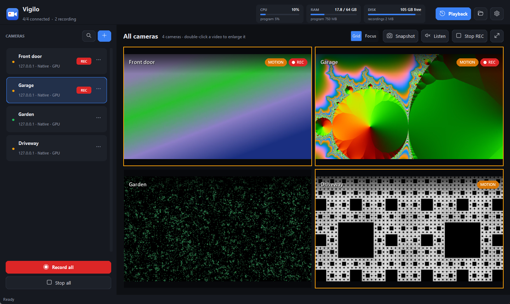
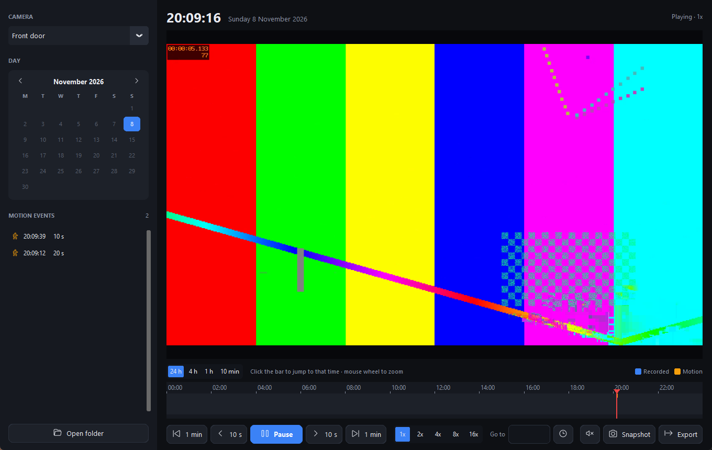
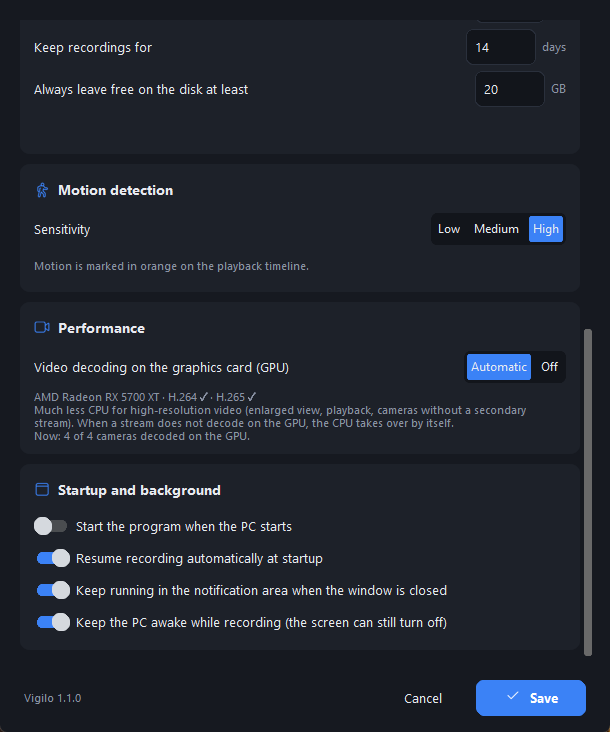
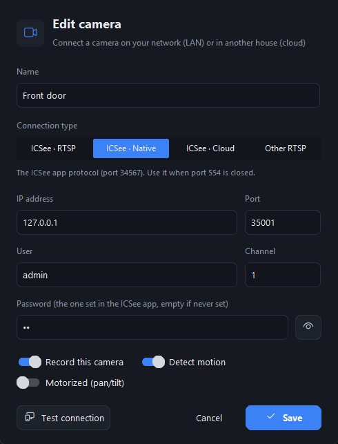
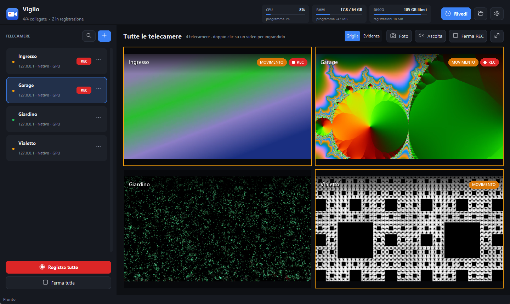

<div align="center">


# Vigilo

**A free, local viewer and recorder for cheap ICSee / XMeye (Xiongmai) IP cameras — and any RTSP
camera — on Windows.**

Live view, 24/7 or motion-only recording to your own disk, playback, PTZ and audio.
No cloud account, no subscription: your video never leaves your PC.

[](https://github.com/CyberTuz/Vigilo/releases/latest)
[](LICENSE)


[**Download**](https://github.com/CyberTuz/Vigilo/releases/latest) ·
[User guide](docs/USER_GUIDE.md) ·
[Guida in italiano](docs/GUIDA_UTENTE.md) ·
[Roadmap](ROADMAP.md) ·
[Changelog](CHANGELOG.md)

</div>



## Why

ICSee / XMeye cameras are cheap and decent hardware with poor software around them: a clunky desktop
client, and a phone app that sends everything through a vendor cloud. Vigilo talks to the cameras
directly on your network and records to a folder on your disk, like a small NVR — in a modern
Windows app with an English and Italian interface.

## Features

**Live view**
- Automatic grid, or *focus* layout (one big camera and the others around it).
- Double-click a camera for full quality, F11 for video-only full screen.
- Motion is highlighted live (orange border and *MOTION* badge).
- Live audio from one camera at a time, like an NVR.
- PTZ for motorized cameras: on-screen pad, arrow keys, named saved positions.

**Recording**
- Straight to disk **without re-encoding** the video (almost no CPU), in small files of 5–30 minutes.
- **Continuous** or **motion-only**: keeps from about 10 s *before* the motion until N minutes after it.
- Audio recorded too, also from cameras that only speak the native protocol (G.711 → AAC).
- **Automatic overwrite**: maximum space, days to keep, minimum free disk space.

**Playback**
- Calendar, zoomable 24-hour timeline with motion events, speed 1x–16x, audio at 1x.
- Snapshots and **MP4 clip export** ready for phones and messaging apps.

**Built to run all the time**
- Closing the window keeps Vigilo in the **notification area** — recording continues.
- Keeps the PC **awake while recording** (the screen can still turn off).
- A small **watchdog** restarts Vigilo by itself if it ever crashes.
- Starts with Windows; ffmpeg processes are tied to the app (no orphan recordings).

**Fast**
- **GPU video decoding** (AMD, NVIDIA and Intel, via D3D11VA) for live view and playback: 60–75 % less
  decoding CPU on full-resolution streams, with automatic fallback to the CPU.
- Light live tiles: the grid uses the cameras' secondary streams.

**Connections**
- **RTSP** (port 554), the **ICSee native protocol** (DVRIP / "Sofia", TCP 34567 — implemented from
  scratch, for cameras without RTSP), **any `rtsp://` URL** (Hikvision, Dahua, Reolink…), and an
  experimental **cloud** connection by serial number.
- **LAN discovery** and a connection test that picks the right protocol and detects PTZ and audio.

| Playback | Settings | Camera |
|---|---|---|
|  |  |  |

## Download and install

1. Download **`Vigilo-<version>-win64.zip`** from the
   [latest release](https://github.com/CyberTuz/Vigilo/releases/latest).
2. Unzip it anywhere (for example `C:\Vigilo`) and run **`Vigilo.exe`**. Nothing else to install:
   ffmpeg and everything else is included.
3. Windows SmartScreen may warn about an unknown publisher (the build is not code-signed):
   *More info → Run anyway*.

To uninstall, delete the folder and `%APPDATA%\Vigilo` (settings). Your recordings stay in
`Videos\Vigilo` until you delete them.

## Quick start

1. Press the **magnifier** to scan your network, then **Add** next to each camera found — the right
   connection type is chosen from the open ports. Or press **+** to add a camera by hand.
2. The user is usually `admin`; the password is the one set in the ICSee app (empty if never set).
3. **Test connection** checks the video, switches RTSP ↔ native if needed and detects PTZ and audio.
4. Recordings go to `Videos\Vigilo\<camera name>\` (change it in **Settings**).
5. **Playback** opens the recordings by day and time.

The full guide is in [docs/USER_GUIDE.md](docs/USER_GUIDE.md).

| Connection type | When to use it |
|---|---|
| ICSee · RTSP | Port 554 is open — the lightest connection |
| ICSee · Native | Port 554 is closed: the ICSee app protocol on port 34567 |
| ICSee · Cloud | A camera in another house, by serial number (experimental, see below) |
| Other RTSP | Any camera with an `rtsp://` address |

## Security and privacy

These cameras are **not secure by design**. Tested on an XM530 camera (2023 firmware):

- **[CVE-2024-3765](https://nvd.nist.gov/vuln/detail/CVE-2024-3765)**: anyone who can reach TCP port
  34567 can read the user list with the password hashes and the **Wi-Fi password** without logging in
  (the hash is as good as the password).
- The vendor software relies on cloud features, automatic firmware updates and weak cryptography.

Recommended setup:

- Put the cameras on a **separate network** (guest Wi-Fi or a VLAN) that only the recording PC can reach.
- **Never forward their ports** on your router. For remote viewing use a VPN to your home (for example a
  Tailscale subnet router): Vigilo then works exactly as on the LAN.
- Give every camera its own password.

Vigilo itself makes no internet connection (except the optional cloud mode). Note that it stores the
camera passwords **in plain text** in `%APPDATA%\Vigilo\config.json`, readable by your Windows user;
encrypting them with Windows DPAPI is on the [roadmap](ROADMAP.md).

## Cloud connection (experimental)

Vigilo can reach a camera in another house through the ICSee / XMeye cloud by its serial number, using
the vendor SDK library `NetSdk.dll` loaded in a separate process (`xmcloud_bridge.py`). It has real
limits:

- The SDK DLL is **not included** (it is proprietary): put `NetSdk.dll` and `StreamReader.dll` in the
  `sdk` folder next to `Vigilo.exe` (see [sdk/README.md](sdk/README.md)).
- The 2024 DLL shipped with VMS refuses third-party logins (error -12003) unless the application
  identifies itself with its own Jftech developer account.
- The older 2019 DLL works without one and reaches cameras through the cloud relay even behind a
  symmetric NAT — but only for cameras on the "old" cloud with a classic `admin` + password login.
- Many recent cameras use a random user name or a login token kept in the owner's cloud account;
  those cannot be reached with a plain user name and password.

For dependable remote viewing a VPN is still the better option.

## Run from source

Windows 10/11 with Python 3.11 (64-bit):

```bash
pip install -r requirements.txt
python vigilo.py
```

`python vigilo.py --no-supervisor` runs without the watchdog, handy for debugging. The diagnostic log
is `%APPDATA%\Vigilo\vigilo.log`; `VIGILO_CONFIG_DIR` points the configuration somewhere else.

### Tests

```bash
pip install pytest
python -m pytest
```

50 tests, about 20 seconds. The end-to-end tests (`-m e2e`) start a fake ICSee camera
(`tools/fake_dvrip.py`, video + G.711 audio) and check login, live video, audio, the connection test,
a real recording to disk, and GPU decoding with its fallback to the CPU. They never touch your real
configuration.

To try the app without any camera:

```bash
ffmpeg -f lavfi -i testsrc2=size=1280x720:rate=15 -t 20 -c:v libx264 -bsf:v h264_metadata=aud=insert test.h264
python tools/fake_dvrip.py test.h264 34567 mypassword
```

Then add a camera of type *ICSee · Native* at `127.0.0.1`, port 34567, user `admin`, password `mypassword`.

### Build the exe

```powershell
powershell -ExecutionPolicy Bypass -File build.ps1
```

Creates `dist\Vigilo\Vigilo.exe` (PyInstaller, one folder) and `dist\Vigilo-<version>-win64.zip`.

## How it works

| Path | Purpose |
|---|---|
| `vigilo.py` | Entry point: the watchdog, which runs the program (`--child`), or the cloud bridge |
| `vigilo_app/dvrip.py` | Native ICSee / XMeye protocol (DVRIP, TCP 34567) |
| `vigilo_app/cloud.py`, `xmcloud_bridge.py` | Cloud connection; the bridge is a separate process that loads NetSdk.dll |
| `vigilo_app/devices.py` | Client by connection type, PTZ controller, connection test |
| `vigilo_app/viewers.py`, `motion.py`, `audio.py` | Live view, motion detection, live audio |
| `vigilo_app/hwaccel.py` | GPU video decoding: detection and ffmpeg options |
| `vigilo_app/recorder.py`, `archive.py`, `player.py` | Recording, recordings on disk and overwrite, playback engine |
| `vigilo_app/system.py`, `supervisor.py` | Windows integration (startup, tray, keep awake, crash log) and the watchdog |
| `vigilo_app/ui/` | CustomTkinter user interface |
| `i18n.py` | Translations (English source text, Italian dictionary) |
| `tests/`, `tools/fake_dvrip.py` | Automated tests and the fake camera |

Video is recorded by ffmpeg with `-c copy` (no re-encoding) into Matroska segments; live view decodes
each camera in its own ffmpeg process (on the GPU when possible) and the UI only draws the latest frame.

**DVRIP in short**: header `struct "<BB2xII2xHI"` (0xFF, version, session, sequence, message id,
length) followed by JSON ending with `\x0a\x00`. Login 1000 with the "sofia" hash (MD5 folded to 8
base-62 characters), OPMonitor claim 1413 / start 1410, media 1412 with frame markers `00 00 01 FC`
(I-frame), `FD` (P-frame), `FA` (audio: media byte 0x0E = A-law, rate byte 2 = 8 kHz), PTZ 1400.

Adding a language: add a dictionary to `i18n.py` and an entry to `LANGUAGES`.



## Contributing

Bug reports and pull requests are welcome. Please run `python -m pytest` before sending a change, and
describe the camera model and firmware when reporting a camera-specific problem. See the
[roadmap](ROADMAP.md) for what is planned next.

## Disclaimer

Vigilo is an independent project, not affiliated with Hangzhou Xiongmai Technology, Jftech or any
camera vendor. ICSee, XMeye and VMS are names of their respective owners and are used only to describe
compatibility. Use Vigilo only with cameras you own or are allowed to access.

## License

Vigilo is released under the [MIT License](LICENSE). The Windows build bundles third-party software
under its own licenses, including FFmpeg (GPL v3): see [THIRD_PARTY_NOTICES.md](THIRD_PARTY_NOTICES.md).
